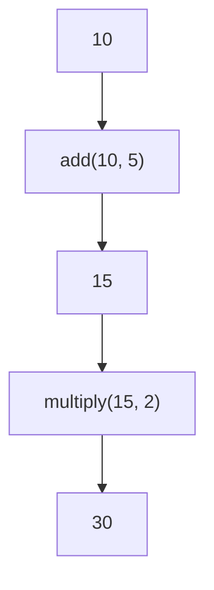

# Pipeline Toolkit

A small functional pipeline toolkit for Python.

`pipeline-toolkit` provides a simple way to build sequential pipelines from ordinary Python callables.

It also provides small utilities for composing functions, configuring callable steps, applying side effects, and managing pipeline state.

A pipeline is created from an iterable of steps. Each step is a tuple containing a callable and optional arguments.

```python
from pipeline import Pipeline

def add(value, amount):
	return value + amount

def multiply(value, factor):
	return value * factor

pipeline = Pipeline([
	(add, (5,)),
	(multiply, (2,)),
])

pipeline.run(10).wait()

print(pipeline.result)  # 30
```

The value flows through each step sequentially:



See the [API Reference](https://pipeline-toolkit.pages.dev) for detailed documentation.

Copyright (C) 2026 Hoàng Long
